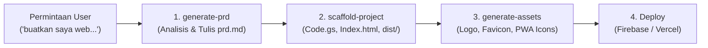
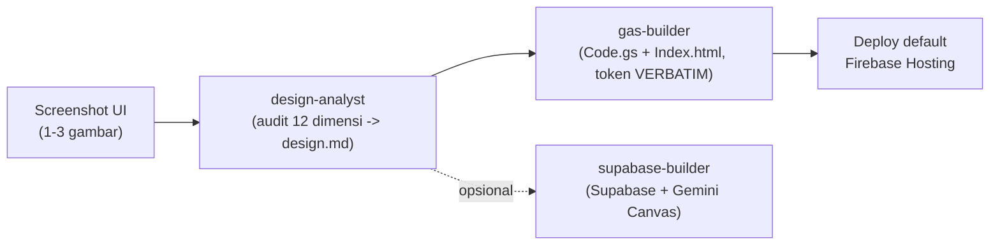

# Mazte Projek Skill (V2.0)

Paket portabel untuk men-generate project web app lengkap dari ide/permintaan singkat hingga siap deploy, mengikuti blueprint **Google Apps Script + Google Sheets + Alpine.js + Tailwind CSS + Firebase Hosting / Vercel** (referensi: Landing Page Ceisya Shop & Gudang Farmasi).

Kompatibel dengan **Google Antigravity CLI**, **OpenCode**, dan AI Coding Assistant lainnya.

---

## Isi Paket

```
Mazte Projek Skill/
├── skills/
│   ├── generate-prd/         # AI System Analyst: membuat prd.md lengkap dari ide singkat
│   ├── scaffold-project/     # Scaffolding: backend Code.gs, frontend Index.html, build pipeline
│   │   └── templates/        # build.js, build.sh, package.json, vercel.json,
│   │                         # firebase.json, .firebaserc, deploy-firebase.bat,
│   │                         # sw.js, manifest.json, .gitignore, AGENTS.md.blueprint
│   ├── generate-assets/      # Generate favicon, logo, PWA icons dari prd.md
│   │   └── templates/        # favicon.svg, logo.svg, logo-192.svg, logo-512.svg,
│   │                         # generate-icons.js (SVG → PNG via sharp)
│   ├── ui-ux-pro-max/        # Skill UI/UX & design system (Tailwind, skema data, warna)
│   ├── design-analyst/       # [BARU] Screenshot UI -> audit 12 dimensi -> design.md
│   │   └── reference/        # uiux-dictionary.md (vocabulary audit)
│   ├── gas-builder/          # [BARU] design.md -> Code.gs + Index.html (GAS, Firebase default)
│   ├── supabase-builder/     # [OPSIONAL] design.md -> app Supabase (Postgres/Auth/RLS)
│   └── antislop/ ...         # [VENDOR] Filter Anti Slop (6 skill) + antislop.md
│                             #   antislop, antislop-ui, antislop-copywriting,
│                             #   antislop-human, antislop-layoutmobile, antislop-code
├── commands/
│   ├── prd.md                # /prd  — generate PRD saja
│   ├── init.md               # /init — auto-generate PRD + scaffold penuh
│   ├── design.md             # /design — analisa screenshot -> design.md
│   ├── build.md              # /build  — design.md -> GAS app + deploy Firebase
│   ├── supabase.md           # /supabase — OPSIONAL: design.md -> app Supabase
│   └── slop.md               # /slop — filter Anti Slop (38 rule + Delivery Gate)
└── STITCH UIUX/              # Dokumentasi alur design-first (lihat STITCH UIUX/README.md)
```

---

## Alur Kerja Otomatis (End-to-End Pipeline)



1. **Langkah 1 (`generate-prd`)**: Saat user meminta *"buatkan saya web landing page"*, *"buatkan web kasir percetakan"*, dsb., skill ini otomatis membedah jenis bisnis, menentukan role, menu, fitur, relasi data, struktur Google Sheets, dan aturan bisnis, lalu menyimpannya ke `prd.md`.
2. **Langkah 2 (`scaffold-project`)**: Membaca `prd.md` dan membuat seluruh file kode: `Code.gs` (Google Apps Script), `Index.html`, `JavaScript.html`, `Stylesheet.html`, `build.js`, dan `AGENTS.md`.
3. **Langkah 3 (`generate-assets`)**: Membaca nama app & palet warna dari `prd.md`, menghasilkan favicon, logo, dan ikon PWA (SVG & PNG).
4. **Langkah 4 (`ui-ux-pro-max`)**: Memastikan hierarki desain, warna Tailwind, dan styling antarmuka sesuai standar UX modern.

---

## Alur Alternatif: Design-First (`design-analyst` → `gas-builder`)

Kalau Anda punya **screenshot UI referensi** dan mau app-nya mengikuti desain itu:



- **`/design`** — upload 1-3 screenshot → audit visual → `design.md` (design system lengkap, token terkunci).
- **`/build`** — `design.md` → `Code.gs` + `Index.html`/`JavaScript.html`/`Stylesheet.html` (Google Apps Script + Google Sheets, Alpine.js + Tailwind) → **deploy Firebase Hosting** (default).
- **`/supabase`** — **OPSIONAL**: `design.md` → app Supabase (Postgres/Auth/RLS) untuk preview single-file.
- **`/slop`** — **filter Anti Slop**: bersihkan UI/copy/aksesibilitas/layout/kode dari ciri output AI, ditutup Delivery Gate PASS/FAIL.

> Detail lengkap: **`STITCH UIUX/README.md`**. Backend default repo ini = **GAS + Google Sheets + Firebase Hosting**; Supabase hanya opsi.

### Filter Anti Slop (vendor)

`skills/antislop*` disalin dari <https://github.com/miqdadbadjuber/anti-slop> (v3.2.20, MIT) — **filter**, bukan sumber arah. Dipakai bersama `design.md`: `design.md` memberi arah, antislop menghapus slop + mewajibkan liveliness. Isi SKILL.md-nya tidak diubah; lihat `skills/antislop/ATTRIBUTION.md`.

---

## Cara Pakai di Antigravity CLI

### Opsi A: Per Project (Workspace)
1. Salin folder `skills/` ke dalam `.agents/skills/` di root project Anda:
   ```
   my-project/
   └── .agents/
       └── skills/
           ├── generate-prd/
           ├── scaffold-project/
           ├── generate-assets/
           └── ui-ux-pro-max/
   ```
2. Buka project di Antigravity CLI.
3. Cukup ketik perintah Anda:
   > *"buatkan saya web toko kasir percetakan"*  
   > atau  
   > *"buatkan web landing page katalog busana"*
4. Antigravity akan otomatis menjalankan **`generate-prd`** untuk membuat `prd.md`, lalu melanjutkan ke **`scaffold-project`**.

### Opsi B: Global (Berlaku untuk Semua Project di Komputer Anda)
Salin folder skill ke `~/.gemini/config/skills/`:
```powershell
# Di PowerShell:
New-Item -ItemType Directory -Path "$HOME\.gemini\config\skills" -Force
Copy-Item -Recurse -Force "skills\*" "$HOME\.gemini\config\skills\"
```
Setelah disalin ke direktori global, di folder project mana pun Anda berada, Antigravity akan selalu mengenali skill Mazte.

---

## Cara Pakai di OpenCode

1. Salin folder `Mazte Projek Skill/` ke root project baru.
2. Buat atau sesuaikan file `opencode.json` di root project:

   ```json
   {
     "$schema": "https://opencode.ai/config.json",
     "skills": { 
       "paths": ["Mazte Projek Skill/skills"] 
     },
     "command": {
       "prd": {
         "description": "Generate prd.md from an app idea.",
         "template": "Generate prd.md using the generate-prd skill in `Mazte Projek Skill/skills/generate-prd/` for: $ARGUMENTS"
       },
       "init": {
         "description": "Scaffold a new project from prd.md (or generate prd.md if missing).",
         "template": "Scaffold this project using skills in `Mazte Projek Skill/skills/`. If prd.md does not exist, use generate-prd first. Then run scaffold-project, generate-assets, and npm run build."
       }
     }
   }
   ```

3. Jalankan di OpenCode:
   - `/init buatkan web toko kasir untuk percetakan`
   - atau `/prd buatkan landing page produk fashion`

---

## Detail Skill `generate-prd`

Ditenagai oleh instruksi **MAZTE Generate Prompt — By @mazteprojek**:
- **Expert System Analyst & Prompt Engineer**: Mengembangkan ide singkat menjadi blueprint arsitektur yang solid.
- **Standar Google Sheets Schema**: Setiap sheet memiliki primary key (`PREFIX-timestamp`), foreign key eksplisit, tipe data, dan header tebal.
- **Standar Apps Script**: Mendefinisikan action `doPost`, caching 60s (`clearDataCache`), dan JSON response.
- **Diagram Mermaid ERD**: Disertakan langsung di dalam spesifikasi teknis untuk visualisasi relasi database.

---

## Deploy ke Firebase Hosting

Setiap project yang di-scaffold sudah dilengkapi konfigurasi Firebase Hosting:
- `firebase.json` (routing static dist/ + cleanUrls)
- `.firebaserc` (konfigurasi Project ID)
- `deploy-firebase.bat` (script otomatis 1-klik untuk build & deploy di Windows)

### Cara Deploy Cepat (Windows):
1. Buat project baru di [Firebase Console](https://console.firebase.google.com/).
2. Klik ganda `deploy-firebase.bat` di root project.
3. Script akan otomatis memeriksa `firebase-tools`, login, menjalankan `npm run build`, meminta Project ID (jika baru pertama kali), dan mendeploy ke Firebase Hosting.

Atau via terminal:
```bash
npm run deploy:firebase
```

Untuk panduan lengkap langkah demi langkah pembuatan project di Firebase Console, lihat **`catatan.md` bagian H**.
